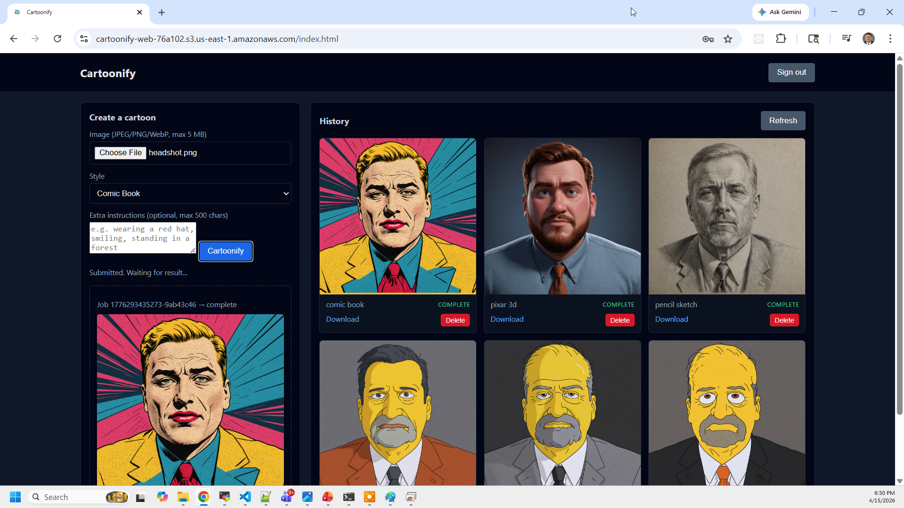

# Photo-to-Cartoon on AWS: Cognito, API Gateway, SQS, Lambda and Bedrock

A serverless **photo-to-cartoon** app. Users sign in with **Cognito**,
upload a photo straight to **S3**, and pick one of six styles. An **API
Gateway HTTP API** with a JWT authorizer queues the job on **SQS**, and a
container-image **Lambda** worker sends the photo to an image model on
**Amazon Bedrock** (Stability's control-structure model by default) and
stores the cartoon. The single-page web app polls for the result and keeps
each user's history.



| Piece | Where | Role |
|---|---|---|
| **cartoonify-user-pool** | Cognito | email sign-in, 12-character passwords, verified email; Hosted UI on `cartoonify-auth-<hex>`; a public SPA client using the authorization code flow |
| **cartoonify-api** | API Gateway, us-east-1 | HTTP API, `$default` stage; five routes, all behind a JWT authorizer for the Cognito client; CORS allows any origin |
| **API functions** | Lambda | `cartoonify-upload-url`, `-submit`, `-result`, `-history`, `-delete`; Python 3.11, 10 s, one shared role |
| **cartoonify-jobs** | SQS | 180 s visibility timeout (longer than the worker's 120 s), 1 day retention |
| **cartoonify-worker** | Lambda | container image from ECR, 2 GB, 120 s; triggered one message at a time |
| **cartoonify-jobs** | DynamoDB | job rows keyed on `owner` (the Cognito user) and `job_id`; `ttl` deletes them after 7 days |
| **cartoonify-media-&lt;hex&gt;** | S3 | private; `originals/<owner>/` and `cartoons/<owner>/`, both expiring after 7 days; CORS for the browser upload |
| **cartoonify-web-&lt;hex&gt;** | S3 | public-read bucket with `index.html`, `callback.html`, `config.json` and `favicon.ico` |
| **cartoonify** | ECR | the worker image |

## Architecture

<picture>
  <source media="(prefers-color-scheme: dark)" srcset="architecture-dark.svg">
  
</picture>

Regenerate with `python3 make_diagram.py`.

- **`01-backend/`**: Cognito, the queue, the jobs table, ECR and both
  buckets.
- **`02-worker/cartoonify/`**: the worker (`app.py`) and its `Dockerfile`.
- **`03-api/`**: the API, its authorizer and routes (`api.tf`), the API
  functions and their role (`lambda-api.tf`, code in `code/`), and the
  worker function, its role and its SQS trigger (`lambda-worker.tf`).
- **`04-webapp/`**: `index.html.tmpl`, `callback.html` and the upload of the
  rendered files.
- **`bedrock-config.sh`**: the model settings, sourced by `apply.sh`,
  `destroy.sh` and `check_env.sh`.

## How a job runs

1. The browser signs in through the Hosted UI and gets tokens back on
   `callback.html`. It sends the token as a bearer token on every API call.
2. `POST /upload-url` returns a presigned S3 POST, valid for 5 minutes, that
   only accepts `image/jpeg`, `image/png` or `image/webp` up to 5 MB, at the
   key `originals/<owner>/<job_id>.<ext>`. The browser uploads directly to
   S3.
3. `POST /generate` checks the style, that the key belongs to this user and
   job and the upload exists, and that the user has made fewer than 10 jobs today (UTC). It writes
   the job row as `submitted` and sends the job to the queue.
4. The worker marks the job `processing`, downloads the original, applies
   its EXIF rotation, crops it to a centred square and resizes it to
   1024x1024 PNG with Pillow, then calls Bedrock with the style's prompt plus any `prompt_extra`, at a control
   strength of 0.7. It saves the PNG to `cartoons/<owner>/<job_id>.png` and
   marks the job `complete`.
5. If anything fails, including a content-filtered result, the worker marks
   the job `error` with a message and doesn't raise, so SQS doesn't retry.
6. The page polls `GET /result/{job_id}`, which returns presigned links to
   both images, valid for 4 hours.

## API

Every route needs `Authorization: Bearer <Cognito token>`; jobs are scoped to
the token's user.

| Method | Path | Function | Returns |
|---|---|---|---|
| POST | `/upload-url` | `upload-url` | presigned POST fields, `job_id` and `key`; body `{"content_type": ...}` |
| POST | `/generate` | `submit` | `202` `{"job_id", "status": "submitted"}`; body `{"job_id", "key", "style", "prompt_extra"}`; `429` once the daily quota is used |
| GET | `/result/{job_id}` | `result` | the job's status, with presigned links once complete |
| GET | `/history` | `history` | the user's last 50 jobs, newest first |
| DELETE | `/history/{job_id}` | `delete` | deletes both images and the job row |

Styles: `pixar_3d`, `simpsons`, `comic_book`, `anime`, `watercolor` and
`pencil_sketch`. `prompt_extra` is optional, up to 500 characters.

## Changing the Bedrock model

Edit the three exports in `bedrock-config.sh`:

```bash
export BEDROCK_MODEL_ID="stability.stable-image-control-structure-v1:0"
export BEDROCK_INFERENCE_PROFILE_ID="us.stability.stable-image-control-structure-v1:0"
export BEDROCK_MODEL_REGIONS='["us-east-1","us-east-2","us-west-2"]'
```

`check_env.sh` checks the profile is available; `03-api` passes it to the
worker as `BEDROCK_MODEL_ID` and grants `bedrock:InvokeModel` on the profile
and on the foundation model in every region it can route to. A model with a
different request format also needs the payload in
`02-worker/cartoonify/app.py` changed, and `WORKER_TAG` in `apply.sh` bumped
so the image is rebuilt.

## Prerequisites

* [An AWS Account](https://aws.amazon.com/console/) with access to the
  Bedrock model above
* [Install AWS CLI](https://docs.aws.amazon.com/cli/latest/userguide/getting-started-install.html)
* [Install Terraform](https://developer.hashicorp.com/terraform/install)
* [Install Docker](https://docs.docker.com/engine/install/) with `buildx`
* [Install jq](https://jqlang.github.io/jq/download/) and `envsubst`

If this is your first time following along, we recommend starting with this
video: [AWS + Terraform: Easy Setup](https://www.youtube.com/watch?v=9clW3VQLyxA).

## Deploy

```bash
git clone https://github.com/mamonaco1973/aws-cartoonify.git
cd aws-cartoonify
./apply.sh
```

Everything deploys to `us-east-1` in four stages:

1. **`01-backend`**: Cognito, the queue, the table, ECR and the buckets.
2. **Worker image**: logs in to ECR and, if the tag in `WORKER_TAG`
   (`worker-rc3`) isn't there yet, builds the image for `linux/amd64` and
   pushes it.
3. **`03-api`**: the API, its functions and the worker.
4. **`04-webapp`**: renders `index.html` and `config.json` with `envsubst`
   and uploads them.

It ends by running `validate.sh`, which only prints the URLs:

```
=================================================================================
  Cartoonify — Deployment validated!
=================================================================================
  API : https://<api-id>.execute-api.us-east-1.amazonaws.com
  Web : https://cartoonify-web-<hex>.s3.us-east-1.amazonaws.com/index.html
=================================================================================
```

## Try it

1. Open the **Web** URL, choose **Sign in**, and create an account in the
   Hosted UI with your email; Cognito emails a verification code.
2. Upload a photo, pick a style, and generate. The cartoon appears when the
   job completes, usually within a minute, and stays in your history for 7
   days.

## Teardown

```bash
./destroy.sh
```

`destroy.sh` destroys `04-webapp` and `03-api`, empties the media bucket
with `aws s3 rm --recursive`, then destroys `01-backend`.

## Notes

- **Lab only.** Anyone can create an account through the Hosted UI. The API
  allows CORS from any origin.
- Each output image costs roughly $0.04 (check Bedrock pricing for your
  model), so the 10-a-day quota caps one user at about $0.40 a day.
- The worker's role also allows `aws-marketplace:ViewSubscriptions`,
  `Subscribe` and `Unsubscribe` on `*`, for models that are sold through
  AWS Marketplace.
- `00-resources/webapp.png` is a different screenshot from the root
  `webapp.png`.
